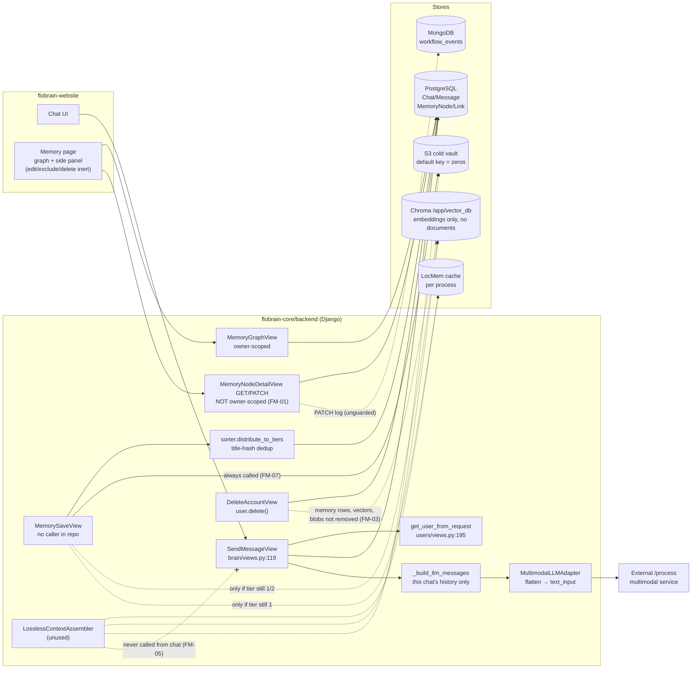

# Current State and Findings

Revision: `67b0153a` (= `origin/main`, 2026-11-02). All paths are relative to the repository root. Line numbers are at that revision. Source IDs (N1–N7) are defined in [README.md](README.md).

**Evidence labels used below**

- **Static**: confirmed by reading current source at `67b0153a`. Not executed in this review.
- **Hist-exec**: reproduced by execution in N3's isolated harness against `ecb0a760`. Those code paths are unchanged at `67b0153a`, but the harness itself (N7) is not available.
- **Reported**: claimed in N2 or N4 without verifiable artifacts.
- **Unexecuted**: a proposed test or reproduction that nobody has run.

No test was executed in this review (see README, "Execution limits").

---

## 1. Actual architecture

### 1.1 Components on the active product path

| Component | Location | Responsibility (actual) | Callers | Failure behavior |
|---|---|---|---|---|
| Auth helper | `flobrain-core/backend/users/views.py:195-212` `get_user_from_request` | Decodes the Bearer access JWT and returns `User` or `None` | All memory and brain views | Returns `None`, so views return 401 |
| Chat orchestration | `flobrain-core/backend/brain/views.py:119-179` `SendMessageView` | Saves the user `Message`, builds the prompt from **this chat's history only** (`_build_llm_messages`, :28-41), calls the adapter, saves the assistant `Message` | Website `POST /api/brain/chats/<id>/send/` | Adapter errors become answer strings (see below). No memory calls at all. |
| LLM adapter | `flobrain-core/backend/brain/llm/multimodal_adapter.py:66-144`, factory `brain/llm/__init__.py` | Flattens messages to `text_input` (:48-63) and POSTs multipart to `{MULTIMODAL_SERVICE_URL}/process` | `SendMessageView` | HTTP and URL errors are returned as `generated_response` text and saved as assistant messages (:88-132) |
| Memory API | `flobrain-core/backend/memory/views.py`, routes in `memory/urls.py` | `GET graph/` (owner-scoped, :71), `GET/PATCH nodes/<id>/` (**not** owner-scoped, :146, :181), `POST save/` (:227-263) | Website memory page (graph and detail only). Nothing calls `save/` in the repo. | Save returns 200 "saved" even when derived writes fail. PATCH commits, then logs to Mongo unguarded. |
| Sorter | `flobrain-core/backend/memory/sorter.py:140-227` | Dedup by **title** (`name`) SHA-256 or MinHash over the 50 most recent nodes, chooses a tier by `importance` (≥0.75 → 1, ≥0.35 → 2, else 3), creates `MemoryNode` | `MemorySaveView` | Raises on DB errors |
| SQL catalog | `flobrain-core/backend/memory/models.py` `MemoryNode`, `MemoryLink`, migration `0001_initial` | `owner_id` is a plain `CharField` (default `"system"`). There is no content field: text lives in `name` or free-form `metadata.raw_text`. There is no version, exclusion or source field. Links cascade on node delete. | All memory code | n/a |
| Tier 1 "active buffer" | `flobrain-core/backend/memory/tier_1.py` | rANS-encodes `metadata.tokens` (never populated) into the Django cache. `settings.py` defines no `CACHES`, so this is a per-process LocMem cache, lost on restart. | `MemorySaveView`, assembler | Returns `False` on error |
| Tier 2 vector + BM25 | `flobrain-core/backend/memory/tier_2.py` | Chroma `PersistentClient("/app/vector_db")` created **at import** (:16-17). `save_to_associative_layer` adds **caller-supplied embeddings only, with no `documents`** (:168-183). `hybrid_search` blends 0.6 vector / 0.4 BM25 over `name`, plus a link-weight boost (:78-158). | Save view, assembler, GC task | One `try` covers everything: a Chroma failure skips BM25 entirely and returns `[]` (:160-165) |
| Tier 3 cold vault | `flobrain-core/backend/memory/tier_3.py` | zstd + AES-GCM + S3. Key from `AES_MASTER_KEY`, **default 64 zeros** (:207-211). boto3 client created at import. `put_object` retries 4× with sleeps (:16-39, :74-77). | Save view (unconditionally), assembler, GC | Returns `False`/`{}` on error |
| Context assembler | `flobrain-core/backend/memory/context_assembler.py` `LosslessContextAssembler` | Builds a context string from the 10 most recent tier-1 nodes (query-independent, :46-54), tier-2 `hybrid_search` with a zero vector when no embedding is given (:56-62), and the 10 most recent tier-3 nodes (:71-79). Counts tokens per block (:117-132). | **Nothing on the product path** (no import in `brain/`) | Falls back to `metadata.raw_text` |
| Maintenance | `memory/reclassification.py`, `memory/tasks.py`, `memory/management/commands/warmup.py` | Celery tasks for GC to tier 3 (which deletes from Chroma, :52), token purge, and Hebbian links from a `cooccurrence_buffer` that nothing writes | No Celery app, worker or beat in `docker-compose.yml`. `warmup.py:2` imports `promote_to_active_context`, which does not exist. | Not running |
| Account deletion | `flobrain-core/backend/users/views.py:284-306` `DeleteAccountView` | `user.delete()`. Chats cascade via FK. `MemoryNode.owner_id` is a string, so memory rows **do not cascade**. | Website profile | n/a |
| Website memory UI | `flobrain-website/src/app/memory/…`, `src/lib/api.ts:164-187` | Graph, filters and detail panel via `getMemoryGraph` / `getMemoryNode` | Users | The "Edit Context", "Exclude from Future" and "Delete Node" buttons have no handlers (`memory-node-side-panel.tsx:313-339`). "Raw Text" shows `name` (:123-124). |

### 1.2 Disconnected or duplicate implementations (none on the chat path)

- MongoDB/FAISS helpers: `memory/workflow_service.py`, `memory/embedding_service.py` (relative index path, :9-10; `faiss` and `sentence_transformers` are not in `requirements.txt`), `memory/hybrid_retrieval_service.py` (global top-k, then an optional user post-filter, :32-40), `memory/knowledge_graph_service.py` (no owner scope).
- `memory/compression.py`: orphaned.
- `flobrain-cloud/app/api/api_v1/endpoints/chat.py:11-26`: vector search whose text mapping is a `TODO`, so context is always empty. Separate FastAPI app with no identity gate.
- `memory/test_crud.py`, `test_mongo.py`, `test_knowledge_graph.py`, `test_embeddings.py`, `test_hybrid_retrieval.py` are **import-time scripts**, not tests. Django's default discovery pattern (`test*.py`) imports them during `manage.py test memory`, which writes to whatever MongoDB is configured. The "Created Edges" output reported in N4 §6.2 is printed by `memory/test_knowledge_graph.py:14`.

### 1.3 Lifecycle diagram (current, evidence-based)

### 1.4 Lifecycle trace (steps 1–9 of the brief)

1. **Identity.** Bearer JWT → `User` (`users/views.py:195-212`). Graph and save use `str(user.id)`. Detail and PATCH ignore it (FM-01).
2. **Saving / extraction.** Saving is manual-only, through `POST /api/memory/save/`, and nothing in the repo calls it. No chat capture (FM-06). No fact extraction exists anywhere.
3. **Validation, normalization, dedup.** No serializer. `dict(request.data)` is trusted except `owner_id`. A client-supplied `id` becomes the primary key (`sorter.py:141`). Dedup uses the title only (FM-12). `memory_type` is ignored, so every node becomes `chunk`.
4. **Storage.** SQL row first. Then archive (FM-07), Chroma (only with a caller-supplied embedding, FM-08) and LocMem. Failures are ignored (FM-04).
5. **Retrieval.** `hybrid_search` exists. It needs a query embedding, has no relevance floor, has BM25 over titles only, and has no lexical fallback when Chroma errors (FM-09).
6. **Context assembly / LLM request.** Not connected. The request contains this chat's full, unbounded history plus a fixed system line (FM-05, FM-13).
7. **Correction / contradiction.** PATCH edits display fields only. Derived stores go stale. No supersession (FM-11).
8. **Exclusion, deletion, account cleanup, retention.** None for memory (FM-03). PATCH logs before/after values to Mongo, which retains memory content.
9. **Background, retries, reconciliation.** No worker. S3 retry sleeps happen inline in the request. No reconciliation of derived stores (FM-04, FM-16).

---

## 2. Reconciliation of historical findings with the current revision

| Historical item | Source | Claim | Status at `67b0153a` | Basis |
|---|---|---|---|---|
| F01 node-ID authorization bypass | N3 | Detail and PATCH read or write any user's node | **Still present** → FM-01 | Static (`memory/views.py:146,181`); Hist-exec |
| Artifact #7 "User isolation: Working" | N2 | All active paths scoped | **Contradicted by code.** Graph and save are scoped; detail and PATCH are not. | Static. N3 governs. |
| N4 §4.6 "detail/patch query by ID and owner" | N4 | Fixed | **Not present** in main or any remote branch | `git grep` across `origin/*` |
| F02 / Artifact #1, #5, #11: memory absent from generation | N2, N3 | Chat never retrieves | **Still present** → FM-05 | Static (`brain/views.py:28-41,161-162`); Hist-exec |
| N4 §4.1 chat integration done | N4 | Retrieval and creation wired into chat | **Not present** in main or any remote branch. Unpublished local work. | → FM-20 |
| Artifact #2, #8: no auto-save from chat | N2 | | **Still present** → FM-06 | Static |
| F03 / Artifact #3: cold migration unconditional | N2, N3 | Every save goes to tier 3 when S3 works | **Still present** → FM-07 | Static (`memory/views.py:247`); Hist-exec |
| Artifact #4 (fix list): caller-supplied embeddings | N2 | Empty list stored | **Still present, refined.** With `[]`, Chroma `add` raises inside a `try` and returns `False`, so the node is simply absent from the vector layer. No `documents` are passed, so Chroma cannot embed server-side either. → FM-08 | Static (`tier_2.py:168-183`) |
| N4 §4.3 "Chroma generates embeddings when not provided" | N4 | | **Not true for main.** Main passes `embeddings=` and no `documents=`. | Static |
| F04 cold hydration wrong argument | N3 | Node passed instead of URI | **Still present** → FM-10 | Static (`context_assembler.py:89` vs `tier_3.py:224-231`); Hist-exec |
| F05 rANS codec corrupts restoration | N3 | | **Still present** (file unchanged) → FM-14 | Hist-exec |
| F06 / Artifact #12: zero AES key default | N2, N3 | | **Still present** → FM-02 | Static (`tier_3.py:208`); Hist-exec |
| F07 corrections split across stores | N3 | | **Still present** → FM-11 | Static (`memory/views.py:185-202`); Hist-exec |
| F08 / Artifact #9, #10: no delete/exclude; account leaves memory | N2, N3 | | **Still present** → FM-03 | Static |
| F09 false success / partial state | N3 | | **Still present** → FM-04 | Static; Hist-exec |
| F10 title-based merge | N3 | | **Still present** → FM-12 | Static; Hist-exec |
| F11 relevance, fallback and budget gaps | N3 | | **Still present** → FM-09, FM-13 | Static; Hist-exec |
| F12 cache defects; no worker | N3, N2 #7 | | **Still present** → FM-14, FM-16 | Static |
| F13 Mongo prototype unsafe | N3, N2 #3 | | **Still present.** Not on the chat path. → FM-16 | Static |
| F14 test and CI gaps | N3 | | **Still present** → FM-15 | Static |
| F15 projection distorts geometry | N3 | Hypothesis | **Unverified** (diagnostic only) → FM-18 | Hist-exec (numeric only) |
| F16 incomplete maintenance (warmup import) | N3 | | **Still present** → FM-16 | Static (`warmup.py:2`) |
| Artifact #10: Raw Text shows `name` | N2 | | **Still present** → FM-17 | Static (`memory-node-side-panel.tsx:123-124`) |
| Artifact #10: mock nodes in empty state | N2 | Fake "Technologies/Robotics" nodes | **Partially applicable.** The page renders `MemoryPlaceholderNodes` when empty (`src/app/memory/page.tsx:6,67`). Whether they read as real memories is a UX judgement. | Static; rendering unexecuted |
| Artifact #4: `API_TO_CATEGORY` key mismatch | N2 | Dead map | **Unverified** (not re-checked; low impact) | — |
| Artifact #2: FAISS rebuild per write; relative path | N2, N3 | | **Still present**, off-path → FM-16 | Static (`embedding_service.py:9-10`) |
| N4 §6.2 "4 tests passed (brain, memory)" | N4 | | **Not reproducible against main (executed 2026-11-02: 3 of 4 `memory.tests` pass, the graph test errors).** `memory/tests.py:22-37` creates nodes with default owner `"system"`, while the graph view filters by the user's ID, so `test_graph_maps_api_visualization_fields_to_model_fields` should raise `KeyError`. N4's run used modified local code, and `manage.py test brain memory` also imported the Mongo demo scripts. | Static. Resolve in T00. |
| N4 §6.5 same-chat recall of the test phrase | N4 | | **Not memory evidence**, as N4 itself notes: the phrase was in the same chat's history | — |

Where sources disagree, **current source at `67b0153a` governs**, then N3's executed checks, then N2 and N4 claims.

---

## 3. Requirements status

- **No approved memory PRD or acceptance spec exists** in the repository or in N1. N1 asks only for validation against "the Supermemory features necessary for FloBrain".
- N4 §8 lists targets: store user and assistant messages, retrieve the top 5, combine history with long-term memory, list/search/delete, owner isolation, 1,000+ messages per user, search under 500 ms, GDPR deletion. **Their origin is not documented.** They are treated as reported targets, not approved requirements.
- N3 §A gives audit criteria. Essential: persistent owned facts, cross-chat recall in the real generation path, dependable update and delete, isolation, bounded context, visible dependency failures. Optional: graph traversal, derived facts, consolidation, document RAG, connectors.
- `docs/architecture/CLOUD_VS_BRAIN.md` describes Pinecone/pgvector in a FastAPI "Cloud". That is aspirational and contradicts the implementation, so it does not govern.
- **This handoff's acceptance criteria are proposals** derived from N3's criteria and the brief. They are not approved product requirements. Performance targets (1,000 messages, 500 ms) are kept as optional measurements (ACC-14).

---

## 4. Finding ledger

Severity: **Critical** (privacy or data-integrity breach, or the core feature is absent), **High**, **Medium**, **Low**.
Priority: **P0** before any multi-user memory use; **P1** for a working lifecycle; **P2** after the baseline; **P3** optional.
Category: **D** confirmed defect, **C** missing capability, **O** operational risk, **I** optional improvement.

### P0: authorization, privacy, integrity

#### FM-01 · Cross-user read and edit of memory nodes by ID · Critical · P0 · D
- **Scenario:** user B calls `GET` or `PATCH /api/memory/nodes/<A's node id>/` with B's own token and receives A's node and connections, or overwrites A's node.
- **Where:** `memory/views.py:146` and `:181` use `MemoryNode.objects.get(id=pk)`. Connected nodes are serialized without an owner check (:149-156).
- **Notion/report:** N3 F01 (Hist-exec: Alice reads and changes Bob's node, 200). N2 #7 wrongly says isolation works. N4 says it was fixed locally, but that fix is not in main.
- **Root cause:** confirmed. The owner filter is missing in both handlers.
- **Verification this review:** **executed 2026-11-02** (Docker, `67b0153a`). The existing tests `test_detail_maps_node_and_connection_fields` and `test_patch_updates_only_real_model_fields` return 200 for a node owned by `"system"` while authenticated as a different user. That is the defect, observed through the real JWT, DRF and Postgres path.
- **Smallest correction:** filter by `owner_id=str(user.id)` and return 404 for foreign or nonexistent IDs. Filter connections to the same owner.
- **Acceptance:** ACC-04 detail and PATCH cases.

#### FM-02 · Archive encryption key defaults to a public all-zero key · High · P0 · D
- **Where:** `memory/tier_3.py:208` `os.getenv("AES_MASTER_KEY", "0" * 64)`, and the module-level `SecureCipher` (:211).
- **Source:** N3 F06 (Hist-exec: the zero key decrypts a sample). N2 #12.
- **Impact:** anyone with bucket access can read archived memory if the key is unset. Whether any deployment used the default is **unknown** (operations question).
- **Correction:** make cold archival opt-in (`MEMORY_COLD_STORAGE_ENABLED`, default off). When enabled, require a valid 32-byte key and refuse archival otherwise. No silent default.
- **Acceptance:** ACC-09 (archival disabled or missing key produces no S3 call, the save still succeeds in tier 1/2, and the state is reported).

#### FM-03 · No delete or exclude; account deletion leaves memory behind · High · P0/P1 · C+D
- **Where:**
  - `memory/urls.py` has no delete or exclude route.
  - The side-panel buttons at `memory-node-side-panel.tsx:313-339` have no `onClick`.
  - `models.py:21` `owner_id` is a plain string, not a foreign key.
  - `users/views.py:304` only calls `user.delete()`.
  - `memory/views.py:204-212` logs before/after values (memory content) to Mongo `workflow_events`.
- **Source:** N3 F08. N2 #9, #10.
- **Impact:** users cannot forget anything. A deleted account's memories, vectors and blobs persist.
- **Correction:** see T11 and T12 (exclusion flag honoured by retrieval, owner-scoped delete across all stores, account purge). Stop logging memory content values.
- **Acceptance:** ACC-05, ACC-06.

#### FM-04 · Save reports success after failed writes; unvalidated payload; PATCH partial state · High · P0/P1 · D
- **Where:**
  - `memory/views.py:244-260` ignores the `False` returns from `migrate_to_cold_storage`, `save_to_associative_layer` and `save_to_active_buffer`.
  - `:241` trusts the raw `request.data`.
  - `sorter.py:141` accepts a client-chosen primary key.
  - `views.py:202` commits, then `_log_memory_event` (:33-43) can raise and return 500 after the mutation.
- **Source:** N3 F09 (Hist-exec).
- **Correction:** a validated serializer, server-generated IDs, an `index_status` recorded per node, a response that reports degraded indexing honestly, and best-effort event logging after commit.
- **Acceptance:** ACC-08, ACC-10.

### P1: the lifecycle does not work

#### FM-05 · Stored memories never reach the LLM request · Critical · P1 · C
- **Where:**
  - `brain/views.py:161` `_build_llm_messages(chat)` reads only `chat.messages` (:28-41).
  - The adapter flattens exactly that list into `text_input` (`multimodal_adapter.py:96`).
  - No module in `brain/` imports `memory`.
- **Source:** N3 F02 (Hist-exec prompt cases). N2 #1, #5, #11. N4's fix is unpublished.
- **Correction:** retrieve owned, eligible, relevant memories for the new user text and add them as a clearly delimited data block in the system section, within a token budget.
- **Acceptance:** ACC-01, ACC-11, ACC-12.

#### FM-06 · Nothing captures memory from chat · High · P1 · C
- **Where:** `SendMessageView` never calls the sorter. There is no other caller of `/api/memory/save/` in the repo.
- **Source:** N2 #2, #8. N3 capability table.
- **Decision:** D1 (default: capture user-authored messages only).
- **Acceptance:** ACC-01 (captured variant), ACC-10 (retried send does not duplicate).

#### FM-07 · Unconditional cold migration overrides tier routing; inline S3 retries · High · P1 · D
- **Where:** `memory/views.py:247`. `tier_3.py:111-145` sets `tier_level=3` on success, so the checks at `views.py:249-253` then skip Chroma and the cache.
- **Source:** N3 F03 (Hist-exec). N2 #3.
- **Hypothesis (unexecuted):** when S3 is unreachable or has no credentials, boto3 raises `BotoCoreError`, and `retry_on_network_error` (:16-39) sleeps about 1 + 2 + 4 s (jittered) inside the request before returning `False`. That adds several seconds to every save.
- **Correction:** archive only when the routed tier is 3 and archival is enabled (with FM-02).
- **Acceptance:** ACC-09.

#### FM-08 · No server-side embeddings; vector layer stores no text · Critical · P1 · D
- **Where:**
  - `memory/views.py:245` `embedding = request.data.get("embedding", [])`.
  - `tier_2.py:171-179` `collection.add(ids, embeddings, metadatas)` with no `documents`.
  - `context_assembler.py:56` and `tier_2.py:191` query with `[0.0]*1536`.
- **Source:** N2 #2, #4 and fix-list #4. N3 E06.
- **Impact:** semantic retrieval is effectively off. Nodes saved without a vector are absent from Chroma. Queries without a vector are meaningless or raise on dimension mismatch, which skips BM25 (FM-09).
- **Correction:** one indexing function that embeds canonical content server-side (D3), upserts to a **new versioned collection**, and records `index_status`. Queries use the same embedding function.
- **Acceptance:** ACC-01, ACC-02.

#### FM-09 · Retrieval: no lexical fallback, no relevance floor, recency-only inclusion, BM25 over titles · High · P1 · D
- **Where:**
  - `tier_2.py:85-165` uses a single `try`: a Chroma error returns `[]` before BM25.
  - There is no minimum score (:130-158).
  - BM25 runs over `name` only (:100-125).
  - `context_assembler.py:46-54,71-79` add the latest tier-1 and tier-3 nodes regardless of the query.
  - Retrieval does not exclude superseded or excluded rows (no such fields yet).
- **Source:** N3 F11 (Hist-exec `retrieval_abstains_unrelated`, `chroma_outage_keyword_fallback`, `hybrid_zero_relevance`).
- **Correction:** run vector and lexical retrieval independently, each failure-isolated. Join every candidate back to SQL with owner and eligibility filters. Apply a configurable minimum score. Drop query-independent recency inclusion from the chat path.
- **Acceptance:** ACC-02, ACC-08.

#### FM-10 · Cold hydration passes a node instead of the vault URI · High · P1 · D
- **Where:** `context_assembler.py:89` `retrieve_from_cold_storage(node)`. The adapter (`tier_3.py:224-231`) expects a URI string, so `get_object` fails on `.startswith`, the error is swallowed and `{}` comes back.
- **Source:** N3 F04 (Hist-exec).
- **Correction:** pass `node.metadata.get("vault_uri")`, and only for the caller's own node.
- **Acceptance:** ACC-09 (archive-only payload recall, with S3 faked at the boto3 boundary).

#### FM-11 · Corrections do not propagate; no supersession · High · P1 · D+C
- **Where:** PATCH allows `name`, `memory_type` and `relevance` only (`memory/views.py:185`). `content_hash`, `metadata.raw_text`, Chroma, cache and S3 stay stale. The schema has no version or supersession field.
- **Source:** N3 F07 (Hist-exec `patch_updates_payload`).
- **Correction:** an editable canonical `content`. On change: update the hash, re-index, invalidate the cache, re-archive or delete the old blob. Add `superseded_by` so a replacing memory hides the old one from recall.
- **Acceptance:** ACC-03.

#### FM-12 · Title-based dedup drops different facts; `memory_type` ignored · Medium · P1 · D
- **Where:** `sorter.py:143-165` hashes and MinHashes `name`, not content, over the 50 most recent nodes, so a different payload under the same title merges into the old node. `:204-213` never passes `memory_type`. There is no uniqueness constraint.
- **Source:** N3 F10 (Hist-exec `dedup_preserves_distinct_payloads`).
- **Correction:** dedup on normalized canonical content per owner. Forward a validated `memory_type`. Make capture idempotent with a unique `(owner_id, source_message_id)`.
- **Acceptance:** ACC-10.

#### FM-13 · No final prompt budget; chat history unbounded; assembler miscounts · Medium · P1 · D
- **Where:**
  - `brain/views.py:28-41` sends the whole chat.
  - `context_assembler.py:117-132` does not count the `"\n"` joins and framing.
  - `tiktoken` may need a network download for BPE data (N3 observed this).
- **Source:** N3 F11 (Hist-exec `context_budget_separators`, synthetic encoder).
- **Correction:** budget the memory block, including framing, and bound history to the most recent turns within a configured budget. Use a tokenizer with a conservative offline fallback. The real limit of the external model is **unknown**, so make it a setting.
- **Acceptance:** ACC-12.

#### FM-15 · Tests and CI cannot detect memory regressions; test discovery runs DB-writing scripts · High · P1 · O
- **Where:**
  - `memory/tests.py` has 4 tests. The fixtures use the default owner `"system"` (:22-37), so the graph test fails on main. **Executed 2026-11-02:** `KeyError: 'node-primary'` at `memory/tests.py:45`; 7/8 of `memory.tests` + `users.tests` pass.
  - Import-time scripts `memory/test_*.py` execute Mongo writes under `manage.py test memory`.
  - `.github/workflows/backend-ci.yml:3-15` runs only for `flobrain-cloud/**`.
  - `website-ci.yml` runs lint, typecheck and build, not Vitest.
- **Source:** N3 F14. N4 §6.2 ("Created Edges" output).
- **Correction:** move or rename the demo scripts out of discovery. Fix the fixtures. Add the memory suite and Core CI (T14).
- **Acceptance:** T00, T01, T14 completion criteria.

#### FM-19 · Unsafe-by-default runtime for tests and dev · Medium · P1 · O
- **Where:**
  - `settings.py:184-186` default `MULTIMODAL_SERVICE_URL` is a public IP.
  - `tier_2.py:16-17` builds a Chroma client at import, writing to `/app/vector_db`.
  - `tier_3.py:210-213` builds a boto3 client at import.
  - `docker-compose.yml` requires a `.env` that is not in the repo.
- **Correction:** lazy, settings-driven clients (vector path, collection name, archive enablement). Tests must fake the adapter, use a temp Chroma directory and patch Mongo logging.
- **Acceptance:** T01 completion criteria.

#### FM-20 · Prior fix work is unpublished · Medium · P1 · O (process)
- **Evidence:** N4 describes changes to `brain/views.py`, `memory/tier_2.py`, `memory/embedding_service.py` and `memory/views.py`. `git grep` for `hybrid_search|distribute_to_tiers|assemble_context` in `brain/views.py` across every `origin/*` branch finds nothing (2026-11-02).
- **Action:** the operator may obtain that diff as reference material. The plan does **not** depend on it.

### P2/P3: operational and optional

| ID | Finding | Where | Sev/Pri/Cat | Status | Recommendation |
|---|---|---|---|---|---|
| FM-14 | rANS codec fails exact restoration (empty for short inputs, reversed order). Cache registry is process-local and lost on restart. No `CACHES` setting. | `memory/tier_1.py:23-138,178-280`; `settings.py` | High (if relied upon) / P2 / D | Hist-exec; unchanged | Do not put tier-1 tokens on the retrieval path. Read canonical content from SQL. Repair or remove the codec only as optional work O1. |
| FM-16 | Duplicate or disconnected stacks: Mongo/FAISS (unscoped expansion, global re-embed), Cloud prototype, Celery tasks with no worker or producer, broken `warmup` import | See §1.2 and `warmup.py:2` | Medium / P3 / O | Static | Keep them disconnected. Do not wire them into chat. Document as non-goals. Optional O2. |
| FM-17 | Side-panel "Raw Text" shows `name`. The detail API does not return content. | `memory-node-side-panel.tsx:123-124`; `memory/views.py:158-171` | Low / P2 / D | Static | Return `content` from detail. Display it. Part of T11. |
| FM-18 | Nonlinear `_apply_manifold_projection` plus float16 may distort similarity | `tier_2.py:36-43` | Low / P2 / I (hypothesis) | Hist-exec numeric only | A new versioned collection (T05) uses plain normalized embeddings from the embedding function. Retire the projection on the new path. |
| FM-21 | Empty-state placeholder nodes may be mistaken for real memories | `src/app/memory/page.tsx:6,67` | Low / P3 / I | Static | Optional UX copy fix (O5). |

---

## 5. Verified, unverified and deployment unknowns

**Verified in this review (static reading at `67b0153a`):** every file and line reference above. Also: `HEAD == origin/main`, the clean tree, the diff from `ecb0a760`, the absence of N4's changes from all remote branches, and that `origin/development` lacks the memory app.

**Executed in this review:** git and inspection commands. Then, after the operator approved Docker Compose, two commands were run in the container (2026-11-02): `manage.py check` (no issues) and `manage.py test memory.tests users.tests` (8 ran, 7 ok, 1 error: the graph-fixture `KeyError`). The detail and PATCH tests passing on a foreign-owned node confirm FM-01. No frontend tests were run (no Node.js on the host).

**Historical execution (N3, `ecb0a760`, code unchanged):** isolated-harness results for F01, F03–F07, F09–F11 and the projection diagnostic. 34 of 44 Vitest tests passed; the 10 failures were dashboard tests missing a `QueryClientProvider`.

**Reported only (N4, unpublished code):** the Django check passed, 4 tests passed, a Chroma insert and query worked, and the same chat recalled a phrase.

**Unknown:**
- the deployed revision and configuration
- whether `AES_MASTER_KEY` or S3 were ever set in any environment
- whether the external `/process` service adds its own memory, has a context limit, or logs prompts
- real retrieval quality and latency
- Chroma persistence across container restarts (the compose bind-mount suggests `flobrain-core/backend/vector_db/`, which is gitignored)
